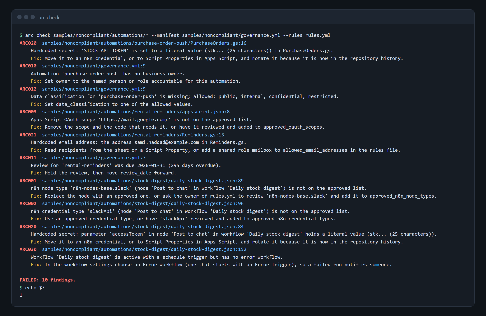

# power-platform-release-checks

A command-line tool and GitHub Action that blocks a Power Platform solution with an unapproved connector, no owner, or an overdue review.



## The need

Staff build Power Automate flows and Power Apps that move organisational data. The governance rules for them (which connectors are allowed, who owns a solution, when it was last reviewed) usually sit in a document that nobody opens at release time. `pprc` turns three of those rules into a check that runs on every pull request, so a solution that breaks them cannot be merged quietly.

## Try it

```
python -m venv .venv
.venv/Scripts/pip install -e ".[dev]"      # Linux/macOS: .venv/bin/pip
.venv/Scripts/pprc check samples/noncompliant --manifest governance.yml --rules rules.yml
```

Real output (also in `docs/sample-output.txt`), exit code 1:

```
PPRC001  samples/noncompliant/Other/Customizations.xml:30
    Connector 'shared_dropbox' (used by connection reference 'nbr_shareddropbox') is not on the approved list.
    Fix: Remove the 'shared_dropbox' action, or ask the governance owner to review it and add it to approved_connectors in the rules file.
PPRC001  samples/noncompliant/Workflows/BackupToDropbox-9E8D7C6B-5A49-4382-9170-F6E5D4C3B202.json:13
    ...
PPRC002  governance.yml:14
    Solution 'NorthbridgeBeneficiaryIntake' has no business owner.
PPRC003  governance.yml:16
    Review for 'NorthbridgeBeneficiaryIntake' was due 2025-01-31 (... days overdue).

FAILED: 4 findings.
```

Options: `--format text|json|github`, `--today YYYY-MM-DD`. `--format github` prints
`::error file=...,line=...,title=...::` workflow annotations. Exit code is 1 on any finding, 0 otherwise.

Use it as an action:

```yaml
- uses: actions/checkout@v4
- uses: ToniHaddad/power-platform-release-checks@main
  with:
    solution: solutions/field-reporting   # the folder from pac solution unpack
    manifest: governance.yml
    rules: rules.yml
```

## How it works

| Input | What is read |
|---|---|
| `Other/Solution.xml` | `SolutionManifest/UniqueName`, the key into the governance manifest |
| `Other/Customizations.xml` | `connectionreferences/connectionreference`, its `connectorid` (for example `/providers/Microsoft.PowerApps/apis/shared_sharepointonline`) |
| `Workflows/*.json` | `properties.connectionReferences`, one entry per connector, `api.name` |
| `rules.yml` | `approved_connectors`, allowed `data_classifications` (organisation rules, not code) |
| `governance.yml` | per solution: `owner`, `data_classification`, `review_date` |

| Rule | Meaning |
|---|---|
| PPRC001 | A connector in use is not on the allowlist |
| PPRC002 | No business owner (blank, or no manifest entry) |
| PPRC003 | Review date overdue, missing or not a date. A review due today is not overdue |
| PPRC004 | Data classification missing or not an allowed value |
| PPRC100 to 104 | A file is missing, unreadable, not well-formed, has an unexpected shape, or the manifest or rules file is broken |

Every finding has the file, the line when it can be known, the rule id and a remediation step. Malformed
input produces a finding (PPRC1xx) and a non-zero exit, never a traceback. Connectors are compared by
their last path segment, case-insensitively, so the full provider id and `shared_x` both work in the rules.

### What was verified against Microsoft documentation

From Microsoft Learn and a published walkthrough of `pac solution clone`: the unpacked layout has
`Other/Solution.xml`, `Other/Customizations.xml` and one JSON file per cloud flow in `Workflows/`;
connection references are defined in `Customizations.xml` as `connectionreference` nodes with a
`connectionreferencelogicalname` attribute and `connectionreferencedisplayname` and `connectorid` children;
a flow JSON has `properties.connectionReferences` keyed by connector name, each with `runtimeSource`,
`connection.connectionReferenceLogicalName` and `api.name`. I did not find an official schema for these
elements, so the exact field names rest on those pages.

**The samples were hand-built to that format. They were not exported from a tenant; there is no tenant here.**
The `Solution.xml` header attributes, GUID file names and the flow `definition` body are plausible but
invented. A real export may contain things this parser has not seen. Canvas apps and model-driven apps in a
solution are not read, only connection references and cloud flows.

## Results

- Compliant sample: 0 findings, exit 0. Noncompliant sample: 4 findings, exit 1. Malformed sample: 2 findings, exit 1.
- `python -m pytest -q`: 22 tests pass. They cover the three samples, each check, the date boundary
  (yesterday, today, tomorrow, not a date, missing), blank owner, missing manifest entry, bad
  classification, broken manifest and rules files, odd flow shapes, and the output formats and exit codes.
- Two real pull requests show the gate working on a solution that starts clean:
  - [PR 1](https://github.com/ToniHaddad/power-platform-release-checks/pull/1) adds a flow that archives to Dropbox. It stays open and its "Check solutions/field-reporting" job fails.
  - [PR 2](https://github.com/ToniHaddad/power-platform-release-checks/pull/2) swaps it for the approved SharePoint connector and passes. It targets PR 1's branch.

The two annotations on PR 1, as GitHub recorded them (the repository is private, so these links need a login):

```
solutions/field-reporting/Workflows/ArchiveReportsToDropbox-4C5D6E7F-8091-4A2B-B3C4-D5E6F7A8B904.json:13
  PPRC001 Connector not on the allowlist
  Connector 'shared_dropbox' (used by flow 'ArchiveReportsToDropbox-4C5D6E7F-...') is not on the approved list.
  Fix: Remove the 'shared_dropbox' action, or ask the governance owner to review it and add it to
  approved_connectors in the rules file.
solutions/field-reporting/Other/Customizations.xml:37
  PPRC001 Connector not on the allowlist
  Connector 'shared_dropbox' (used by connection reference 'nbr_shareddropbox') is not on the approved list.
```

## What a static scan cannot see

This tool reads files from source control. These checks need live tenant information and are outside it:

- **Data loss prevention policies.** Which connectors a Power Platform environment blocks or groups as business
  or non-business is set in the tenant. The allowlist here is the organisation's own list, not a mirror of the DLP policy.
- **Who a flow or app is shared with.** Sharing, co-owners and run-only users are tenant data, not part of the
  solution files.
- **The real connection owner.** A connection reference names a connection slot. The account whose credentials
  fill it, and whether that is a personal or a service account, is only known after import in an environment.
- **Whether the flow is turned on, how often it runs, and what data actually flows through it.**

## Where it fails

- **Minified flow JSON gets no line number.** The line search starts after the line holding `connectionReferences`,
  so when a whole flow sits on one line the finding names the file but has no line. I hit this with a one-line
  test flow (`PPRC001  .../Workflows/a.json` with no `:line`). Pretty-printed exports, which `pac solution unpack` writes, are fine.
- A connector used by an action but absent from `connectionReferences` is now caught from the action's `host`
  object (found by hand-testing, fixed, covered by a test), but only when the action carries a `host` with
  `connectionName` or `apiId`. Other shapes are not seen.
- HTTP actions to arbitrary URLs are not connectors and are not flagged.
- Review dates are compared to the clock of the machine running the check. `--today` exists for reruns.

## What I would add next

- Read canvas app connection references and compare the flow's `connectionReferenceLogicalName` with those defined in `Customizations.xml`.
- Optionally fetch the real DLP policy through an admin API in a separate, credentialed job, and diff it against `rules.yml`.

## Licence

MIT. Author: Toni Haddad. All names in the samples are fictional.
